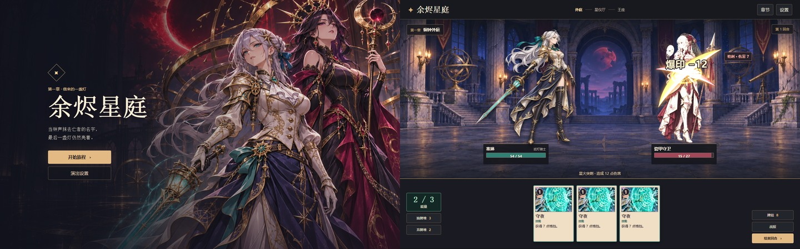

# Ember Court

[简体中文](README.md) · English

**[Play in your browser](https://keaideppk.github.io/ember-court/)**

Ember Court is an anime-inspired fantasy deckbuilder. This playable build includes Chapter One, *A Borrowed Flame*, and supports desktop browsers and mobile touch controls. The game itself is in Simplified Chinese.

> When the bells erase the names of the dead, lantern knight Celine carries the last flame into Ember Court. The queen on the throne remembers every person the city has lost, and why she erased their names.

## How to play

- Draw five cards and regain three energy each turn. Check the enemy’s next move before choosing whether to attack, block, or apply Ember Marks.
- Play 刻下灼印 to apply marks, then use 星火突刺 to consume them for bonus damage.
- Win two encounters to reach a two-phase boss. After each regular encounter, you can add one of three reward cards to your deck.
- You can skip pre-battle dialogue. Open 演出设置 to mute sound or reduce motion and flashes.

## Play offline

Open [index.html](index.html) on GitHub, use the file’s download button, and open the downloaded file in your browser. The artwork is embedded in the single HTML file.

The characters, card art, and environments were created for Ember Court. The illustrations were generated with GPT Image 2.6.
