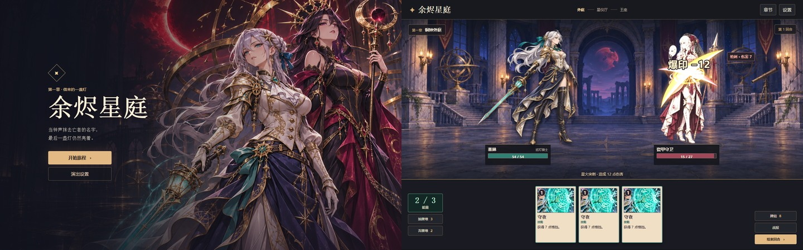

# 余烬星庭

简体中文 · [English](README.en.md)

**[在线游玩](https://keaideppk.github.io/ppk-ember-court/)**

《余烬星庭》是一款二次元奇幻牌组构筑游戏。游玩版包含五章战役，支持桌面浏览器和手机触控，游戏界面为简体中文。

> 当钟声抹去亡者的名字，巡灯骑士塞琳提着最后一盏灯走向星庭。王座上的女王仍记得城里的每个死者，也记得自己为什么抹去了他们的名字。

## 玩法

- 新旅程可选灼印、剧毒、魅惑、反击、连击或召唤。每套形态都有八张起始牌和一个被动。
- 每回合抽五张牌，通常恢复三点能量。看清敌方行动预告，再决定攻击、格挡或继续叠加状态。
- 战后从三张牌中选一张加入牌组。六种流派形态的战利品中，至少一张匹配主流派。当前有 47 种可入组卡牌。
- 第二章通关后，从两个分支中选一个进阶，获得新造型、额外被动和每战可用一次的终结技。
- 战前剧情可跳过，战前自动存档。通过「演出设置」可以静音或减弱动作与闪光。

角色、卡图和场景为本作制作，插画使用 GPT Image 2.6 生成。
